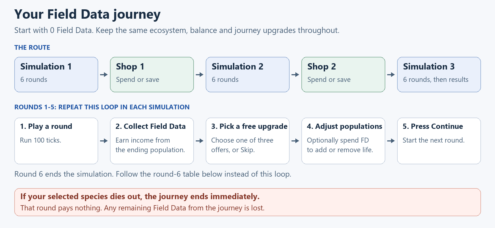

# Field Data Implementation — Process Design

- **Document:** PDD-FD-001, draft 0.1
- **Prepared:** 2026-10-15
- **Readability revision:** 2026-10-16, player-process overview only
- **Product baseline:** [Field Data and Journey Loop Design v1.0](FIELD_DATA_JOURNEY_DESIGN.md)
- **Technical companion:** [Solution Design, SDD-FD-001](FIELD_DATA_SOLUTION_DESIGN.md)
- **Decision owner:** Bevin; sprint scheduling remains with Salty
- **Status:** process proposal for review; no implementation or test execution performed

## 1. Purpose and scope

Deliver the first playable Field Data journey through the existing Desktop
simulation. This document describes the player process, its controls and
exceptions, and the delivery process the team can follow to implement it.
The solution design maps this process onto code and data ownership.

The product baseline controls amounts, prices, reward cadence, upgrade scope and
success/failure behavior. This draft does not reopen those decisions. It adds a
proposed implementation sequence and evidence requirements. A completed stage
must have the stated evidence before its delivery checkbox is marked complete.

The slice contains Simulation → Shop → Simulation → Shop → Simulation,
18 rounds of 100 ticks, six population controls, income modifiers, signed Hare
shop effects, free rewards and paid income reordering. Permanent-currency
rewards/conversion, external-player research and additional content are deferred.

## 2. Starting point and required change

Current source already provides continuous simulation boundaries, a journey-local
wallet, free species upgrades, a seeded Add Hare path and a Noesis journey UI.
It does not implement the complete approved Field Data slice.

| Current process observed in source | Required process |
| --- | --- |
| Six-phase preview and a two-cycle journey prototype | Three six-round simulation nodes with two shop visits |
| Population income settled in preview boundary/completion handlers | One identifiable settlement per successful round, plus distinct node-clear awards |
| One-Hare purchase using existing progression currency | All six fixed-quantity controls with atomic rejection and last-selected-individual protection |
| Existing species rewards and condition-node claims | Approved free round/node rewards, shop offers and explicit income modifiers |
| Progression is reset on a legacy next-simulation path | One continuous world and retained journey progression across this slice |
| Profile currency/unlock storage exists separately | Preserve it; perform no Field Data cash-out in this slice |

These are source observations, not evidence that either the old or proposed
runtime satisfies the new contract. The [baseline source audit](FIELD_DATA_JOURNEY_DESIGN.md#appendix-b--source-audit-and-remaining-implementation)
and solution-design source map record the controlling files.

## 3. Participants, inputs and outputs

| Participant | Responsibility |
| --- | --- |
| Team member playing the internal slice | Choose rewards, population actions, shop purchases and reorders; review the resulting simulation |
| Journey process | Own the route position, allowed actions, settlement and terminal result |
| Simulation process | Advance the one retained ecosystem only while running |
| Design owner | Review material design deviations and accept/revise the loop from evidence |
| Implementation owner and code reviewer | To be assigned by the team when implementation is scheduled; not assigned by this draft |
| Sprint planner | Salty incorporates approved delivery work into team planning |

Inputs are the selected scenario, seed, participating species/Genome snapshot,
versioned Field Data settings and ordered player actions. The world is created
once at journey launch. Outputs are the current board, a journey balance,
reward/purchase receipts, upgrade acquisition and execution histories, and a
success/failure result. Internal runs additionally produce reproducible evidence.

## 4. End-to-end player process

Start with **0 Field Data** and play through **three simulations**, visiting a
shop between them. Each simulation has six rounds. Keep the same ecosystem,
Field Data balance and journey upgrades as you move along the route.

[Open the full-size diagram](diagrams/field-data-player-process.png) ·
[Editable SVG](diagrams/field-data-player-process.svg)

**The normal round loop:** Play 100 ticks → collect Field Data → choose one
free upgrade or Skip → optionally buy population changes → press Continue.
This applies to rounds 1–5 of each simulation. The ecosystem stays paused while
you make these choices. Income upgrades affect later payouts.

**Round 6 finishes a simulation.** If your selected species survives, collect
the round's normal Field Data payout and an extra **10 Field Data** for clearing
the simulation. What happens next depends on where you are in the journey:

| After round 6 of… | What you do next |
| --- | --- |
| Simulation 1 or 2 | Choose one free node upgrade or Skip. Optionally buy population changes on the results screen, then enter the shop. Buy journey upgrades, reorder income upgrades, or save your Field Data. When ready, continue to the next simulation with the same ecosystem. |
| Simulation 3 | The journey succeeds. Review your results and leftover Field Data. There are no more upgrade choices or population purchases; leftover Field Data is discarded when you leave the results. |

**If your selected species dies out at any point, the journey fails immediately.**
That includes the final tick of a round: you receive no payout, reward choice or
clear bonus for that round. Ending or abandoning an unfinished journey also
counts as failure. Lose the journey's remaining Field Data; previously banked
Desktop currency and unlocks stay intact.

The numbered steps below contain the detailed implementation requirements.

### P-01 — Launch and freeze inputs

Resolve the chosen scenario, species/Genome state and Field Data definitions.
Create a new journey identity, one simulation world and one zero-FD progression.
Capture the settings needed to reproduce it. Do not carry local upgrades or FD
from a previous journey; permanent Desktop currency/unlocks remain intact.

### P-02 — Run and pause

Advance the retained runner to the next 100-tick boundary, or terminate on
selected-species extinction. On a normal boundary, pause before presenting any
reward or purchase. Keep the same board, tick sequence, resource state, creature
identities and rules through all three simulation nodes and both shops.

### P-03 — Settle the successful round

Capture all ending species counts before interventions change them. Use the
selected-species count for base income, apply active income operations in
effective order, round down once and add the award to the journey balance.
Publish the population snapshot, ordered calculation and resulting balance.
The same boundary cannot settle again when a screen reopens or Continue repeats.

### P-04 — Resolve the free reward

After local rounds 1–5, offer three distinct eligible free choices or Skip.
After Simulation 1 and 2 clear, offer the free node choice instead. Income
upgrades compete with ordinary species upgrades in one pick-one choice.
Eligibility does not guarantee an income offer. Skip has no reward or penalty.
An income acquisition affects the next unsettled round payout, not the one
just shown. A reward choice is not a purchase from the journey wallet.

### P-05 — Apply population interventions

At each ordinary round break, and at nonterminal round-6 results before the
shop, show all six controls with their cost/effect. One click requests one
purchase. Validate funds, valid placement/targets and the final-selected-
individual guard before committing any effect. A rejection changes neither
balance nor board. Each accepted purchase changes the board and visible wallet
immediately; the player may repeat while eligible. A mid-round pause is not an
intervention window. No controls remain after terminal success.

### P-06 — Complete a simulation node

After its sixth successful round payout, mark the simulation node complete and
automatically award its provisional 10-FD bonus once. Present population income
and the bonus as separate entries. For nodes 1 and 2, resolve the node reward,
allow the result-screen population controls, then enter the shop. Simulation 3
continues directly to success results after settlement.

### P-07 — Visit the shop

Generate and retain five seeded distinct offers using the approved pool and
visit eligibility. Permit multiple distinct purchases, once per offered item.
Retain purchased journey upgrades and the same wallet. The second shop makes
×2 eligible; it does not guarantee that offer.

Show a capped species offer as unavailable with its optional free reroll. Allow
one free reroll per capped offer, using eligible replacements and preserving
same-visit exclusions. Keep fewer offers if the pool cannot supply replacements.

Random and chosen income reorders are available only here. Random executes
without a preview. Chosen exposes a draft sequence, preview and confirmation;
cancel commits nothing. Every successful paid reorder of either kind advances
the shop's shared price step. Leaving the shop resumes the same world; it does
not recreate the board or progression. Species shop effects begin in the next
simulation and income changes first affect its next unsettled payout.

### P-08 — End the journey

On failure or incomplete-route abandonment, capture the remaining FD as the
amount lost, clear the journey wallet, and show failure results. Do not credit
or debit banked Desktop currency/unlocks. On success, display the leftover FD
and discard it when results close. Start a later journey with new local state.
Profile playtime/tick accounting is a separate existing concern; banked-state
checks must not mistake legitimate time accounting for an economy write.

## 5. Controls and exception handling

| Trigger | Required process response |
| --- | --- |
| Extinction, including a round's final tick | Fail before that round's payout/reward/clear bonus |
| Insufficient FD, too few targets or insufficient full-batch space | Reject atomically; retain wallet and board |
| Removal would eliminate the selected species | Block the purchase without charging |
| Old screen submits an action for a resolved reward/offer | Reject stale intent; do not grant or charge again |
| Same valid population control clicked again deliberately | Treat as a new purchase, subject to current validation |
| Capped species offer | Disable buying; offer the approved optional free reroll |
| Chosen reorder cancelled | Keep sequence, balance and price step unchanged |
| Shop or results reopened | Reuse the visit and settlement records; do not regenerate/pay again |
| Definition/input validation fails | Do not launch a partially configured journey; report the actionable issue |
| Unexpected internal arithmetic/state error | Preserve diagnostic evidence; do not silently wrap values, invent a loss or credit the profile |

## 6. Proposed implementation stages

These stages are delivery units, not a sprint assignment. Each should be a
bounded reviewable change with its own evidence. Do not mark later stages done
because earlier tests pass.

| Stage | Work and output | Evidence needed to leave the stage |
| --- | --- | --- |
| FD-I01 — Establish contracts | Capture current behavior, frozen definition shape and source/test baseline; choose exact integration files from the solution draft | Valid definitions, source/ID mapping, regression baseline and reviewed ownership |
| FD-I02 — Journey and settlement | Retain one world/progression for the route; implement the one settlement path, wallet lifecycle and terminal rules | Fixtures for all 18 boundaries, last-tick extinction, repeated callbacks, success/failure/reset and protected banked state |
| FD-I03 — Interventions | Deliver six controls through atomic deterministic population changes | Add/remove by species, capacity, no-charge rejection, final-individual guard and pre-shop round-6 cases |
| FD-I04 — Offers and upgrades | Deliver free/shop eligibility, signed shop effects/caps, ordered income, rerolls and reorders | Exact math, opposing cancellation at bounds, source activation timing, seeded offers and all price/charge rules |
| FD-I05 — Noesis integration | Present receipts, controls, shop and reorder draft in the canonical Desktop route | Runtime interaction, disabled/stale command checks, repeated open/close, full-route continuity and visual review |
| FD-I06 — Reproducible evidence | Extend the existing runner/report path to execute this same journey domain and its actions | Unity/headless parity for bounded fixtures; versioned manifest, ledger and deterministic replay; no duplicate economy implementation |
| FD-I07 — Internal comparison | Freeze 200 seeds and matched arms, run the approved protocol, review self-play and related-value adjustments | Complete run statuses, paired results, team observations and an explicit accept/revise decision |

FD-I02 and FD-I03 can be verified before the full shop presentation exists.
The approved feature acceptance route remains all five nodes. Any temporary
developer fixture must be labelled as such and must not become a reduced
product scope by accident.

## 7. Verification and internal test process

First prove domain correctness and focused runtime integration. Then complete
the full-route and UI checks, establish runner parity, and execute the matched
panel. The current batch tools do not yet constitute a Field Data journey
runner; an ordinary seeded ecology run is insufficient evidence for FD-I06/07.

For every comparison arm, use the same **200 frozen seed IDs**, scenario and
initial species/Genome inputs. Record the build, definition/catalog fingerprints
and ordered actions. Start each independent seed/arm afresh; preserve the same
world only within its three simulation nodes. Record aborted/crashed runs rather
than silently replacing them or treating them as ordinary journey failures.

Collect the existing approved measures: first affordability node/round/tick and
balance; each offer's buy/skip, price and remaining FD; pre-purchase shop balance;
real time and simulation ticks between decision opportunities; and qualitative
team observations. Paused decision time can advance while simulation ticks stay
fixed. Automated tick measurements do not stand in for real human decision time.

Compare emergency 10-FD spending with saving for the 50-FD ×2 offer, recording
actual offer availability. Compare weaker and stronger paths from matched
inputs. Related economy values may change together as a recorded bundle; do not
attribute the result to one number in that bundle. Hold ecology values stable.

The team records accept/revise from repeatable evidence and notes. This process
adds no numeric survival/population gate, external participant interviews,
teach-back, telemetry dashboard or automatic rebalance. Choose subsequent
content only after reviewing findings.

## 8. Evidence and handoff outputs

Use the existing artifact conventions. A minimal comparison bundle contains a
manifest, run statuses, immutable inputs or their retrievable snapshots, ordered
economy events, objective metrics and a separate team analysis/decision note.
Reports must identify which facts came from a run and which are interpretation.
Exported timing, currency and histories must have units and stable identities.

Before handing work to another developer, update the numbered delivery checklist
from actual evidence, add a dated handoff, and link current state. Keep all
evidence local until publication is authorized. An authorized later push includes
the usual Trello/Obsidian handoff; this draft schedules no external updates.

## 9. Traceability and draft review

| Process coverage | Existing checklist IDs | Solution-design area |
| --- | --- | --- |
| P-01/P-02 launch and continuity | 1.01, 4.06–4.07, 4.20–4.24 | Ownership, route and compatibility |
| P-03/P-06 settlement | 1.08–1.23, 4.12–4.18, 4.25–4.26 | Receipt identities and ordered calculation |
| P-05 interventions | 1.02–1.07, 2.02–2.06, 2.18, 4.08, 4.19 | Staged population transaction |
| P-04/P-07 rewards and shops | 2.07–2.17, 4.09–4.11, R.01–R.09, 4.27–4.28 | Definitions, offers, effects, deterministic ordering |
| Internal comparison | 3.01–3.15, 5.01–5.16 | Shared runner, reports and validation |

Review the proposed stage boundaries and technical companion together. Product
rules are already in the baseline; file/type names, helper composition and
headless integration are implementation proposals. The team still needs to
assign implementation/review owners and freeze execution inputs when it
schedules the work. No stage is marked delivered by authoring this draft.
