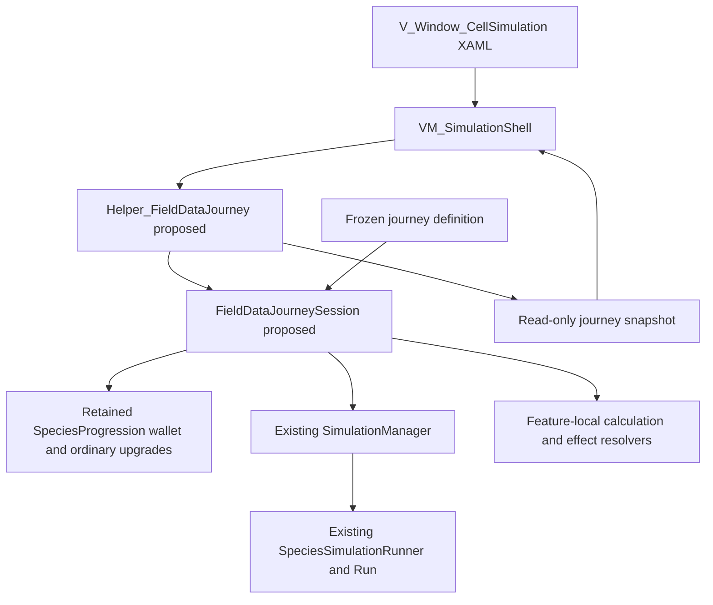

# Field Data Implementation — Solution Design

- **Document:** SDD-FD-001, draft 0.1
- **Prepared:** 2026-10-15
- **Source baseline:** `735b189c`, branch `BevBranch`, plus inspected local files
- **Integration review:** 2026-10-16, merged `0928359` including `ProjectMain` through `341cc702`
- **Product authority:** [Field Data and Journey Loop Design v1.0](FIELD_DATA_JOURNEY_DESIGN.md)
- **Process companion:** [Process Design, PDD-FD-001](FIELD_DATA_PROCESS_DESIGN.md)
- **Status:** proposed technical design; types/APIs described as proposed do not exist yet

## 1. Outcome and constraints

Implement the approved five-node journey using the existing simulation and UI.
Keep one world, one journey wallet and one authority for each reward or purchase.
Make income, offer generation and interventions reproducible from frozen inputs
and ordered actions. Preserve banked Desktop currency/unlocks and legacy
research semantics outside the explicitly selected Field Data path.

This draft defines an implementation approach, not new economy rules. It adds
no package, service, generic modifier engine, global event bus or persistence
migration. All prices, strengths and reward schedules come from the baseline.
The process document defines delivery stages FD-I01 through FD-I07.

## 2. Current implementation and integration seams

The [combined planning draft](FIELD_DATA_AND_SIMULATION_ALIGNMENT.md) records
the integration update: retain Salty's scrolling map and profile-v2 feature
availability, reuse the new-journey Field Data reset, and keep the exact
five-node test route explicit. These additions do not implement shops, the
third simulation, ordered income or permanent reward settlement. No new profile
schema migration is proposed by this Field Data slice; protect existing
`UnlockedFeatureIds` along with the other banked state.

The following entries are observed in source. They are not proposed filenames
or runtime validation claims.

| Existing source | Observed responsibility and required seam |
| --- | --- |
| [SpeciesProgression.cs](../Assets/Scripts/Game/Species/SpeciesProgression.cs) | Owns integer `Currency`, ordinary upgrade levels/rules and ordered acquisitions; reuse its wallet without keeping a second mutable balance |
| [SimulationManager.cs](../Assets/Scripts/Game/Simulation/SimulationManager.cs) | Owns one runner, fixed-step timing, boundary/completion events and continuation; retain this tick authority |
| [Helper_Simulation.cs](../Assets/Scripts/Game/Simulation/Helper_Simulation.cs) | Unity-facing forwarding API to that manager; use explicit composition |
| [SpeciesSimulationRunner.cs](../Assets/Scripts/Game/Simulation/SpeciesSimulationRunner.cs) | Applies rules at boundaries, owns `previousCells`, adds boundary population and advances using seed plus absolute tick |
| [SimulationRunResult.cs](../Assets/Scripts/Game/Simulation/SimulationRunResult.cs) | Contains `SimulationRunState`, phase state/history, target ticks, checkpoints and population snapshots |
| [SpeciesSimulation.cs](../Assets/Scripts/Game/Simulation/SpeciesSimulation.cs) | Provides deterministic simulation and existing addition candidate selection; removal and resource-aware purchase behavior need extension |
| [SpeciesCell.cs](../Assets/Scripts/Game/Species/SpeciesCell.cs) | Distinguishes creatures, terrain resources and occupied plant entities; removal must preserve unrelated cell contents |
| [SpeciesSimulationPreview.cs](../Assets/Scripts/Game/Presentation/SpeciesSimulationPreview.cs) | Unity compatibility controller for existing launch, rewards, wallet settlement and journey presentation; new-mode delegation must bypass legacy award/reset paths |
| [JourneyNodeAsset.cs](../Assets/Scripts/Game/Simulation/JourneyNodeAsset.cs), [JourneyMapAsset.cs](../Assets/Scripts/Game/Simulation/JourneyMapAsset.cs) | Authored nodes, edges, map placement and prototype eligibility; currently no Shop kind |
| [SpeciesUpgrade.cs](../Assets/Scripts/Game/Species/SpeciesUpgrade.cs), [SpeciesUpgradeContract.cs](../Assets/Scripts/Game/Species/SpeciesUpgradeContract.cs) | Positive legacy upgrades and explicit snapshots; the legacy constructor and avoidance-bonus field cannot directly represent negative shop offers |
| [SpeciesAttributeRegistry.cs](../Assets/Scripts/Game/Species/SpeciesAttributeRegistry.cs) | Stable additive species attributes and explicit rule application; avoidance currently lives in a separate bonus/options path |
| [VM_SimulationShell.cs](../Assets/UI/HUD/Scripts/VM_SimulationShell.cs), [V_Window_CellSimulation.xaml](../Assets/UI/HUD/XAML/V_Window_CellSimulation.xaml) | Noesis bindings, existing rewards/map commands and layout; extend presentation without moving calculations into it |
| [ProfileSessionSnapshot.cs](../Assets/Scripts/Game/Profile/ProfileSessionSnapshot.cs), [Helper_ProfileSession.cs](../Assets/Scripts/Game/Profile/Helper_ProfileSession.cs) | Permanent profile state and time accounting; Field Data must not call currency/unlock mutation APIs |

Two specific hazards shape this design. Preview boundary and terminal callbacks
currently settle through separate guards. Also, legacy next-simulation flow can
reset progression, while boundary additions update a restart grid as well as the
current grid. None of those behaviors should be reused blindly for the new
retained-world journey.

## 3. Proposed ownership and components



Proposed components are feature-local additions in `SaltyGame.Runtime`, with
plain deterministic domain code under `Assets/Scripts/Game/Simulation` and the
Unity helper under `Assets/Scripts/Game/Presentation`. Names may be refined
during code review; this is not an instruction to create empty scaffolding.

| Proposed type/file | Concrete responsibility |
| --- | --- |
| `FieldDataJourneyDefinition.cs` | Immutable resolved route, offer, price, reward and version data; small typed definition records may share this file |
| `FieldDataJourneyDefinitionAsset.cs` | One designer-authored definition asset that validates and freezes the concrete starter slice; no runtime mutable wallet/offers in the asset |
| `FieldDataJourneySession.cs` | Route/choice/shop state, settlement identities, owned income/shop instances and committed transaction records; holds the existing manager and one retained progression explicitly |
| `FieldDataIncome.cs` | Pure ordered payout and reorder-price calculations, producing numerical breakdowns |
| `FieldDataSpeciesEffects.cs` | Recompute net signed shop effects over ordinary species state, including explicitly mapped avoidance options and bounds |
| `FieldDataJourneySnapshot.cs` | Immutable/read-only gameplay facts for display: phase, counts, receipts, balance, offers, orders and allowed actions |
| `Helper_FieldDataJourney.cs` | Unity composition/subscriptions and lifecycle forwarding; returns session snapshots, exposes intent methods and never references Noesis controls or ViewModels |

`SpeciesProgression.Currency` remains the only wallet during this slice. The
session may expose a derived read-only balance, but must not cache another
authoritative number. Retain the same progression instance across shops and all
18 rounds. Ordinary upgrade levels remain in progression; shop family counts
and income instances have their own explicitly separate ledgers.

The helper receives the manager through an explicit internal composition seam
on `Helper_Simulation`, not scene discovery. The session uses that manager for
domain operations. `SpeciesSimulationPreview` delegates Field Data-mode flow
and maps its status for legacy presentation compatibility; it must not keep an
independent competing journey state or continue awarding currency in that mode.

The existing preview update remains the sole Unity clock forwarder to the
manager. The new helper subscribes to lifecycle events; it must not advance the
same manager a second time. Pair bind/unbind and session disposal with Unity
lifecycle and test repeated window opening/closing.

## 4. Definition, identity and runtime data

Resolve authoring once at launch. Validate route connectivity, the exact five
node kinds/order, three six-round simulations, positive round length, all offer
IDs, supported effects/targets, unique display slots, source eligibility and
valid costs. Reject malformed definitions before creating an active journey.

| Runtime record | Minimum contents |
| --- | --- |
| Definition snapshot | Version/fingerprint; route/node IDs; round/reward cadence; six intervention definitions; income and shop species catalogs; prices/caps and reorder rules |
| Journey identity | Unique attempt identity, scenario/input fingerprint, seed and source/build version |
| Round identity | Journey identity plus global round 1–18; local round and simulation index are derived |
| Award identity | Round identity plus `PopulationPayout` or `NodeClear`; use the same identity for repeated callbacks |
| Offer identity | Journey, source kind, node/round, slot and generation; record stable catalog ID separately |
| Owned upgrade instance | Acquisition ordinal/instance ID, source offer, resolved effect, scope, tick and first effective payout |
| Purchase/reorder request | Unique intent ID and expected state revision; a retry of that intent must not charge twice |
| Receipt | Event/request identity, tick, pre/post balance, cost/award, exact resolved effect and status |
| Income histories | Append-only acquisitions; current ordered instance IDs; accepted reorder records with before/after order |

Real time is evidence metadata, not an input to random draws or payout amounts.
Do not use asset paths, display names, GUIDs or process-dependent string hash
codes as gameplay identity. Asset GUIDs may remain additional provenance.

The solution uses a simple flow enum, proposed as `Running`, `RoundChoice`,
`PopulationWindow`, `NodeChoice`, `NodePopulationWindow`, `Shop`, `Succeeded`,
`Failed`, `Closed`. This is state data in the session, not a state-pattern
framework. The low-level run remains `AwaitingDecision` throughout nonterminal
choices, results and shops; its status is not the journey's complete flow state.

## 5. Continuous route and lifecycle

Configure the new run for 100-tick continuous phases and target tick 1,800.
Derive `simulationIndex = (globalRound - 1) / 6` and
`localRound = ((globalRound - 1) % 6) + 1`. Do not replace legacy global
six-phase constants in place: the frozen definition selects this route only.

At absolute ticks 600 and 1,200, hold the existing runner at its boundary while
settlement, node rewards, interventions and shop actions occur. Apply the
resulting rules/options through the existing boundary-installation seam before
calling Continue once. Keep `previousCells`, creature IDs, cooldowns, resources,
metrics and Genome snapshot. Never call the initial-grid factory or legacy
`PlayNextSimulation` reset to enter the next node.

At tick 1,800, the existing run can report `Complete` without raising an
`AwaitingDecision` event. Its completion callback must invoke the same settlement
operation for successful round 18, then clear/finish the node. Check the selected
population before that operation even when the runner has already become
`Complete`; final-tick extinction must still fail without that payout/bonus.

Manual End/abandon uses the same terminal failure operation from any incomplete
journey state. Success-result exit discards its displayed leftover FD and closes
the session. A new journey constructs fresh local state; it is not a reset of
selected fields on the old session. This draft adds no player-facing checkpoint
save/resume feature.

## 6. Exactly-once settlement and arithmetic

Both boundary and completion callbacks call one proposed domain operation,
`SettleSuccessfulRound(roundIdentity, capturedPopulation)`. The settled-award
ledger belongs to the session, not to screen booleans. It returns the existing
receipt on replay without changing the wallet.

```text
verify journey/round identity and exact completed boundary
check extinction or early-abandonment first
if population award already settled: reuse its frozen receipt
otherwise:
    freeze all ending species counts and active income order
    compute full population payout and one final floor
    validate the complete wallet addition before committing
    commit award, receipt and settlement identity together
if local round 6: settle distinct node-clear award once
reconcile the appropriate flow without resetting a resolved choice/visit
return the population receipt and any node-clear receipt
```

The final-round payout and the node bonus are separate transactions with stable
identities and separately visible balances. A retry between them can finish the
missing bonus without replaying the population award. Serialize in-memory
commands on the existing main-thread flow; no callbacks may observe a partially
committed transaction.

The calculator starts at the selected-species count. `AddPerHare` adds the ending
Hare count at its current position; `MultiplyPopulation` multiplies the running
amount. Scope-filter operations before executing them. Store numeric intermediate
amounts and operation IDs for the receipt; the ViewModel formats the explanation.
Use decimal/rational constants for 1.5, 2 and price growth, then floor once.

Proposed bounded implementation: retain the existing checked integer wallet for
compatibility and preflight all conversions/additions. Arithmetic out-of-range
is a technical fault with an unchanged wallet and actionable diagnostic, not an
invented gameplay cap, wrapped balance or ordinary failed journey. Do not remove
the uncapped income-acquisition rule to conceal a numeric implementation limit.

Reorder pricing uses `ceil(10 × (11/10)^k)` for random and exactly 10 times that
charged integer for chosen. Both successful modes increment `k`; reset it only
for a new shop visit. Check values 10/100, 11/110, 13/130 and 14/140. Do not
calculate chosen as `ceil(100 × 1.1^k)`, which would break the approved exact
10× relationship after rounding.

## 7. Atomic, species-aware population changes

Extend the domain with a proposed prepare/commit boundary-change operation.
Keep the legacy addition API and restart behavior compatible for existing callers.
The new journey path operates on the current board and does not require empty
space on a copy of the initial board, as the current addition path does.

1. Validate flow/revision, species, signed quantity, funds, full capacity/targets
   and final-selected-individual protection.
2. Select the complete deterministic candidate set without modifying live cells
   or allocating new creature identities. Stage candidate coordinates and the
   validated resulting balance/rules data.
3. Revalidate session/run revision and commit through the session's serialized
   command path. Do potentially throwing validation/allocation work before live
   assignments; allow no intervening callbacks or spending between preflight and
   the coordinated board/wallet commit.
4. Publish a new boundary snapshot and receipt only after both effects commit.
   On any ordinary rejection, retain board, wallet, offer state and action/RNG
   counters. Test that the next valid action is unaffected by a rejected one.

Animals and plants need separate cell operations. Removing an animal uses the
entity layer and preserves its underlying resource/terrain. Removing a plant
resource uses `WithoutPlantResource` behavior and preserves any creature and
its identity/state. Adding Plants must create valid authored resource cells,
following the terrain/resource semantics of `SpeciesInitialGridFactory`, rather
than blindly treating every species as a creature. Candidate checks must ensure
each counted addition is genuinely new, use the proper species/resource ID and
respect passability and the existing maximum-population interpretation.

Update the current boundary state and `previousCells` consistently so the next
step cannot resurrect removed entities or use an obsolete grid. Preserve the
receipt's pre-purchase closing population: the existing boundary install replaces
the latest history sample, so a payout must not later read that mutable sample
as its original basis. Log interventions separately from natural births,
predation and other deaths; do not distort existing ecology counters.

Repeated intentional clicks obtain new request IDs and may each buy another
batch. A retry of one request ID is idempotent. Do not globally deduplicate all
same-species actions at one tick, which would prevent approved repeat buying.

## 8. Signed species effects and independent caps

Keep `SpeciesProgression` as the ordinary-upgrade base, not an incrementally
modified storage place for shop overlays. Recompute effective runtime rules from
that base plus the full net signed shop ledger. Otherwise a later positive/
negative pair can retain clamping loss or ordinary upgrades can apply an old shop
bonus twice. Install the resolved rules at the next simulation boundary without
healing, refilling, resetting cooldowns or reinitializing creatures.

Track three purchased copies per shop family across signs and future targets,
independently of ordinary upgrade levels. Net cancellation does not return a
copy slot. Apply final attribute bounds after summing the family contribution.
Use current constraints: nonnegative movement/block/digestion; probability and
crowding-energy-reduction values within 0–1. Display/record the resolved bounded
effect so a saturated stat is not represented as a full effective change.

Five families have existing rule-attribute IDs. Sharper Instinct requires an
explicit signed avoidance path: the existing `PreContactAvoidanceChanceBonus`
accepts only 0–1 and the ordinary progression computes avoidance separately.
Propose a stable avoidance attribute entry in the single registry, with an
explicit resolver into experimental/options state rather than `SpeciesRules`.
Keep the old positive snapshot contract compatible; do not pass a negative value
through its constructor or force it into a rule property that does not exist.
Authoring validation, runtime application, fingerprints and telemetry must agree
on that mapping before a shop asset can enter a run.

This resolver is for the six selected shop effects. It is not a scripting DSL or
a generalized modifier/plugin system. Existing additive snapshot application and
historical ordinary-upgrade fingerprints retain their meanings.

## 9. Offers, reorders and deterministic actions

Generate an offer set once per source event/visit and keep it. Purchase and
reroll act on offer identity and state revision, not on a UI list index alone.
Use the frozen definition for five distinct shop offers, equal shop weighting,
no same-visit opposite pair, source gating and second-shop ×2 eligibility.
Free reward sets have three distinct choices or fewer when needed, with Skip.

Retain capped shop offers as locked when drawn so their optional reroll is
possible. Reroll replacements must avoid capped/invalid items, duplicates and
the opposite of any same-visit family offer, including already purchased offers.
Record one free reroll use for the capped offer. If no replacement is available,
reduce the displayed set. Buying uses one receipt and marks that offer consumed;
acquiring an equivalent later distinct offer is allowed under its applicable cap.

The current ecology runner derives randomness from seed plus absolute tick; it
does not expose a long-lived `Random` state to serialize. Preserve that scheme
and `previousCells`. Derive economic random seeds from a versioned stable mix of
journey seed, source/node/round identity, operation kind and accepted operation
ordinal. Keep offer, intervention and reorder streams distinct so cancelling a
shop UI draft cannot consume ecology randomness. Use existing deterministic
helpers where possible; do not use wall time, `UnityEngine.Random` or unstable
`string.GetHashCode()`.

Random reorder must produce a different permutation of owned instance IDs.
Chosen reorder accepts an exact permutation of those IDs, rejecting missing or
duplicate instances. Draft previews never mutate the committed sequence, price
step, acquired instances or wallet. Confirmation rechecks current revision,
funds and price; cancellation does nothing. A later acquisition appends to the
current effective order, leaving the acquisition history untouched.

## 10. Noesis projection and commands

Add a journey binding seam to `VM_SimulationShell` while keeping existing
non-Field-Data preview bindings intact. `Helper_FieldDataJourney` exposes a
read-only snapshot and a feature-local change notification. The ViewModel owns
display strings and uncommitted reorder UI state; the session owns gameplay.
The existing per-frame shell refresh is a compatibility surface, not a reason
to recompute offers/payouts every frame. Project only a changed state revision.

Proposed intents include reward choice/Skip, population purchase, shop purchase,
capped-offer reroll, random reorder, chosen-reorder preview/confirm/cancel,
Continue/enter-shop, End and close terminal results. Give commands authoritative
availability and reject disabled/stale intents again in the domain. Helpers
must not reference a ViewModel or XAML control.

Extend `V_Window_CellSimulation.xaml` and its existing resource dictionary for
balance/count/breakdown lists, six controls, shop cards and reorder presentation.
A separate shop panel is justified if it isolates a coherent view, not merely
for decorative sub-controls. Keep the current batched board renderer, sprite
atlas, zoom/pan and terrain resolver. Populate it from the updated authoritative
board projection; never infer transactions from rendered sprites.

## 11. Authoring, compatibility and rollout

Append `Shop` to `JourneyNodeKind` without changing existing serialized numeric
values (current kinds occupy 0–5). Add an optional explicit Field Data definition
reference to the authored map/composition; a null reference preserves the legacy
path. Resolve selection from this definition, not asset filenames or scene names.
Create the five-node map and definition as a bounded authoring change, preserving
existing node GUIDs and the historical prototype for regression coverage.

Wire the slice through the canonical Desktop simulation when ready for team
review. A temporary opt-in path can help staged development, but it is not a
substitute for the final player entry point. Review only the necessary references
on composition hosts such as [CellularAutomataPrototypeRuntime.cs](../Assets/Scripts/Game/CaveGeneration/CellularAutomataPrototypeRuntime.cs)
and [GalapagOSDesktopNoesisHost.cs](../Assets/UI/GalapagOS/Scripts/GalapagOSDesktopNoesisHost.cs).
The new Unity helper is composed explicitly alongside the existing helper and
preview, never discovered through global lookup.

Preserve existing public APIs, default six-round fixtures, ordinary mutation
caps and legacy report interpretation. Route the selected new mode past legacy
`AddCurrency`, reward generation and progression-reset branches exactly once;
do not leave both settlement paths active. No profile schema migration or
permanent-reward integration is required. Protect currency/unlock fields while
allowing existing independent profile playtime accounting.

Rollback is to deselect the explicit new definition and revert the bounded
implementation changes, retaining the old prototype and frozen evidence. It
must not require deleting PlayerPrefs, rewriting historical reports or clearing
another developer's uncommitted files.

## 12. Evidence, headless integration and the 200-seed panel

Use the same domain session/calculators in Unity and the existing standalone
path. [CellSim.Batch.csproj](../Tools/CellSim.Batch/CellSim.Batch.csproj) explicitly
lists and embeds shared sources: add the required feature domain files and
`SimulationManager` to both its compilation/provenance set as needed. A copied
second economy implementation would not establish parity.

The current `CellSim.ps1 Run`/standalone schedules do not already expose this
journey economy. Add an explicit opt-in journey definition and action schedule
to the runner/report path before claiming 200-seed support. Extend the existing
entry points and serializers rather than adding a parallel dashboard or batch
service. Freeze historical runners; new evidence uses a new version/fingerprint.

Add a versioned Field Data section containing definition/input fingerprints,
ordered intents and receipts, payout/population snapshots, offer histories,
owned/acquisition/execution orders, route/terminal outcome and both timing units.
Allow old reports without that optional section to retain their meanings.
Do not relabel purchase removals as predator kills, or a technical runner crash
as extinction. Capture partial statuses and preserve completed evidence.

For each arm, run the same 200 seeds from matched fresh inputs. Use recorded
decisions or a declared internal policy; record actual offer availability. If
an offer needed by an intended strategy is absent, report that fact rather than
substituting a different draw. Bounded source-exercising fixtures can force a
shop/reward case for correctness testing without changing live random rules.

Compare Unity and headless receipts/order/board outcomes on focused fixtures
before expanding the panel. Keep objective run data separate from team notes
and accept/revise decisions. Automation captures ticks and its own runtime;
actual self-play supplies human deliberation time and qualitative observations.
Existing export defaults such as population success floors must not become a
new Field Data acceptance threshold.

## 13. Verification map

The following are required future checks, not test results from this draft.

| Target | Proposed checks / existing test location to extend | Process stage |
| --- | --- | --- |
| Calculator and pricing | Proposed feature-local EditMode cases: order 80 vs 60, one final floor, scopes, activation and exact price growth/10× ratio | FD-I01/04 |
| Settlement and lifecycle | Extend [SimulationManagerTests.cs](../Assets/Tests/Runtime/SimulationManagerTests.cs): 18 rounds, hold at 600/1200, successful terminal callback, extinction at 100/600/1800 and idempotent retries | FD-I02 |
| Population transaction | Same runtime suite plus feature cases: six controls, both cell layers, full capacity, last-individual block, repeated valid clicks versus retried intent, no rejected-action side effects | FD-I03 |
| Signed effects and catalog | Extend [SpeciesUpgradeContractTests.cs](../Assets/Tests/Runtime/SpeciesUpgradeContractTests.cs), [SpeciesDomainTests.cs](../Assets/Tests/Runtime/SpeciesDomainTests.cs): six signed families, bounds/cancellation, avoidance mapping, separate caps and ordinary-rule regression | FD-I04 |
| Definitions/map | Extend [JourneyMapAssetTests.cs](../Assets/Tests/Editor/JourneyMapAssetTests.cs) and authoring checks: new route, stable enum values, valid definition, cap/eligibility fingerprints | FD-I01/05 |
| Runtime UI and banked state | Extend [SpeciesPresentationPlayModeTests.cs](../Assets/Tests/PlayMode/SpeciesPresentationPlayModeTests.cs), [GenomeContractTests.cs](../Assets/Tests/Runtime/GenomeContractTests.cs), Desktop/visual tests: entry point, command state, repeat open/close and unchanged currency/unlocks | FD-I05 |
| Evidence parity | Extend shared runner/report fixtures and [SimulationReportTelemetryTests.cs](../Assets/Tests/Editor/SimulationReportTelemetryTests.cs): new schema, unchanged old interpretation, replay and Unity/headless parity | FD-I06 |
| Internal comparison | Frozen 200-seed arms, full statuses and team review; no numeric acceptance gate or new content before findings | FD-I07 |

Use the documented [Unity validation workflow](UNITY_PLUGIN_WORKFLOWS.md):
focused checks during development, then full relevant-suite/integrated-route
acceptance and visual evidence. Preserve real profile saves in fixtures. A
standalone build is not a Unity runtime or visual acceptance result.

## 14. Technical choices proposed for review

| Choice | Proposal and reason |
| --- | --- |
| Wallet authority | Retain one `SpeciesProgression.Currency`; avoids a second wallet and broad caller migration |
| Journey authority | One feature-local plain C# session; avoids growing gameplay ownership in the ViewModel or duplicating the simulator |
| Unity seam | Explicit helper binding and legacy-preview delegation; keeps Noesis separate and existing entry points usable |
| Authoring | One typed definition snapshot/asset plus an explicitly selected map; keeps prices tunable and runs frozen |
| Effects | Net signed shop overlay plus an explicit avoidance mapping; satisfies cancellation without altering legacy additive semantics |
| Transactions | Serialized, revision-checked staged commit and identity-keyed receipts; supports repeated actions and safe retries |
| Replay | Versioned deterministic operation identities and shared domain source; avoids wall-clock randomness and duplicated economy code |

These are draft implementation decisions for review alongside PDD-FD-001. The
gameplay rules stay in the approved baseline. No proposed class, enum value,
asset, API, runner option or test case is claimed to be implemented by this
document.
