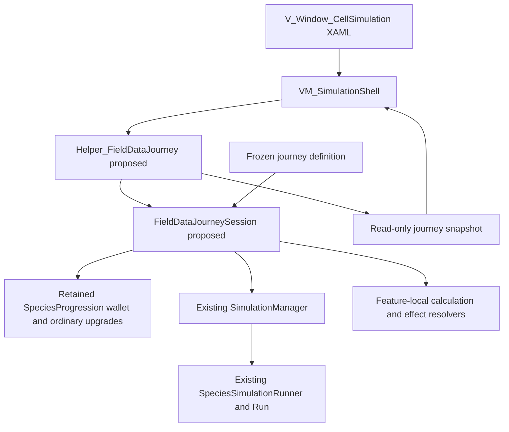

# Field Data Implementation — Solution Design

- **Document:** SDD-FD-001, draft 0.1
- **Prepared:** 2026-10-15
- **October21 human acceptance:** Bevin accepts this initial five-node implementation and confirms APS fixed in play. This supersedes the earlier open human-acceptance checkpoint below; it does not approve new content or complete production polish. See the [acceptance record](FIELD_DATA_SELF_PLAY_REVIEW.md).
- **October 19 evidence refresh:** Current authored export and direct Unity/headless parity pass eight action fixtures (including all six skills owned before round 7); 600/600 current-rule journeys validate across 200 matched seeds and three policies. See the [report](Research/Experiments/FD-Current-Loop-Refresh-20261019/REPORT.md). No tuning or human acceptance is inferred.
- **October 19 correction:** Field Data Hare skill rewards repeat to their existing per-skill level caps. Eligibility and reward application use the same cap; legacy authored single-use upgrades retain their contract. Empty/missing Field Data offers never display legacy priced cards. See the [round-7 handoff](handoffs/2026-10-19-fd-round7-reward-exhaustion.md).
- **Node-navigation revision:** 2026-10-18 — player-controlled map entry between nodes, with no node-end population controls. See the [implementation handoff](handoffs/2026-10-18-fd-node-map-navigation.md).
- **Source baseline:** `735b189c`, branch `BevBranch`, plus inspected local files
- **Integration review:** 2026-10-16, merged `0928359` including `ProjectMain` through `341cc702`
- **Product authority:** [Field Data and Journey Loop Design v1.1](FIELD_DATA_JOURNEY_DESIGN.md)
- **Process companion:** [Process Design, PDD-FD-001](FIELD_DATA_PROCESS_DESIGN.md)
- **Status:** Initial five-node slice accepted by Bevin on October21,2026; APS fix confirmed in play. Further content/polish remain future work. The [acceptance record](FIELD_DATA_SELF_PLAY_REVIEW.md) preserves observations, prior verification and unrecorded metadata.

## 1. Outcome and constraints

Implement the approved five-node journey using the existing simulation and UI.
Keep one world, one journey wallet and one authority for each reward or purchase.
Make income, offer generation and interventions reproducible from frozen inputs
and ordered actions. Preserve banked Desktop currency/unlocks and legacy
research semantics outside the explicitly selected Field Data path.

This draft defines an implementation approach, not new economy rules. It adds
no package, service, generic modifier engine, global event bus or persistence
migration. All prices, strengths and reward schedules come from the baseline.
The process document defines delivery stages FD-I01 through FD-I07.

The [ticket draft](FIELD_DATA_TICKET_DRAFT.md) translates those stages and this
technical proposal into reviewable work. All 16 are selected in the
[Active S5 control](Sprints/S5-control-record.md), October 19-November 15,
2026. As of October 19, T01–T12 are implemented, T14's direct parity and T15's
matched study have refreshed current-rule evidence, and T13/T16 retain their
human acceptance and recorded self-play decision work. Journey settlement,
launch integration, shops and the signed species catalog are implemented;
the sections below retain the design's architectural approach and earlier
integration baseline rather than implying those systems are still absent.

## 2. Current implementation and integration seams

The [combined planning draft](FIELD_DATA_AND_SIMULATION_ALIGNMENT.md) records
the integration update: retain Salty's scrolling map and profile-v2 feature
availability, reuse the new-journey Field Data reset, and keep the exact
five-node test route explicit. These additions do not implement shops, the
third simulation, ordered income or permanent reward settlement. No new profile
schema migration is proposed by this Field Data slice; protect existing
`UnlockedFeatureIds` along with the other banked state.

The following entries are observed in source. They are not proposed filenames
or runtime validation claims.

| Existing source | Observed responsibility and required seam |
| --- | --- |
| [SpeciesProgression.cs](../Assets/Scripts/Game/Species/SpeciesProgression.cs) | Owns integer `Currency`, ordinary upgrade levels/rules and ordered acquisitions; reuse its wallet without keeping a second mutable balance |
| [SimulationManager.cs](../Assets/Scripts/Game/Simulation/SimulationManager.cs) | Owns one runner, fixed-step timing, boundary/completion events and continuation; retain this tick authority |
| [Helper_Simulation.cs](../Assets/Scripts/Game/Simulation/Helper_Simulation.cs) | Unity-facing forwarding API to that manager; use explicit composition |
| [SpeciesSimulationRunner.cs](../Assets/Scripts/Game/Simulation/SpeciesSimulationRunner.cs) | Applies rules at boundaries, owns `previousCells`, adds boundary population and advances using seed plus absolute tick |
| [SimulationRunResult.cs](../Assets/Scripts/Game/Simulation/SimulationRunResult.cs) | Contains `SimulationRunState`, phase state/history, target ticks, checkpoints and population snapshots |
| [SpeciesSimulation.cs](../Assets/Scripts/Game/Simulation/SpeciesSimulation.cs) | Provides deterministic simulation and existing addition candidate selection; removal and resource-aware purchase behavior need extension |
| [SpeciesCell.cs](../Assets/Scripts/Game/Species/SpeciesCell.cs) | Distinguishes creatures, terrain resources and occupied plant entities; removal must preserve unrelated cell contents |
| [SpeciesSimulationPreview.cs](../Assets/Scripts/Game/Presentation/SpeciesSimulationPreview.cs) | Unity compatibility controller for existing launch, rewards, wallet settlement and journey presentation; new-mode delegation must bypass legacy award/reset paths |
| [JourneyNodeAsset.cs](../Assets/Scripts/Game/Simulation/JourneyNodeAsset.cs), [JourneyMapAsset.cs](../Assets/Scripts/Game/Simulation/JourneyMapAsset.cs) | Authored nodes, edges, map placement and prototype eligibility; currently no Shop kind |
| [SpeciesUpgrade.cs](../Assets/Scripts/Game/Species/SpeciesUpgrade.cs), [SpeciesUpgradeContract.cs](../Assets/Scripts/Game/Species/SpeciesUpgradeContract.cs) | Positive legacy upgrades and explicit snapshots; the legacy constructor and avoidance-bonus field cannot directly represent negative shop offers |
| [SpeciesAttributeRegistry.cs](../Assets/Scripts/Game/Species/SpeciesAttributeRegistry.cs) | Stable additive species attributes and explicit rule application; avoidance currently lives in a separate bonus/options path |
| [VM_SimulationShell.cs](../Assets/UI/HUD/Scripts/VM_SimulationShell.cs), [V_Window_CellSimulation.xaml](../Assets/UI/HUD/XAML/V_Window_CellSimulation.xaml) | Noesis bindings, existing rewards/map commands and layout; extend presentation without moving calculations into it |
| [ProfileSessionSnapshot.cs](../Assets/Scripts/Game/Profile/ProfileSessionSnapshot.cs), [Helper_ProfileSession.cs](../Assets/Scripts/Game/Profile/Helper_ProfileSession.cs) | Permanent profile state and time accounting; Field Data must not call currency/unlock mutation APIs |

Two specific hazards shape this design. Preview boundary and terminal callbacks
currently settle through separate guards. Also, legacy next-simulation flow can
reset progression, while boundary additions update a restart grid as well as the
current grid. None of those behaviors should be reused blindly for the new
retained-world journey.

## 3. Proposed ownership and components



Proposed components are feature-local additions in `SaltyGame.Runtime`, with
plain deterministic domain code under `Assets/Scripts/Game/Simulation` and the
Unity helper under `Assets/Scripts/Game/Presentation`. Names may be refined
during code review; this is not an instruction to create empty scaffolding.

| Proposed type/file | Concrete responsibility |
| --- | --- |
| `FieldDataJourneyDefinition.cs` | Immutable resolved route, offer, price, reward and version data; small typed definition records may share this file |
| `FieldDataJourneyDefinitionAsset.cs` | One designer-authored definition asset that validates and freezes the concrete starter slice; no runtime mutable wallet/offers in the asset |
| `FieldDataJourneySession.cs` | Route/choice/shop state, settlement identities, owned income/shop instances and committed transaction records; holds the existing manager and one retained progression explicitly |
| `FieldDataIncome.cs` | Pure ordered payout and reorder-price calculations, producing numerical breakdowns |
| `FieldDataSpeciesEffects.cs` | Recompute net signed shop effects over ordinary species state, including explicitly mapped avoidance options and bounds |
| `FieldDataJourneySnapshot.cs` | Immutable/read-only gameplay facts for display: phase, counts, receipts, balance, offers, orders and allowed actions |
| `Helper_FieldDataJourney.cs` | Unity composition/subscriptions and lifecycle forwarding; returns session snapshots, exposes intent methods and never references Noesis controls or ViewModels |

`SpeciesProgression.Currency` remains the only wallet during this slice. The
session may expose a derived read-only balance, but must not cache another
authoritative number. Retain the same progression instance across shops and all
18 rounds. Ordinary upgrade levels remain in progression; shop family counts
and income instances have their own explicitly separate ledgers.

The selected route is previewed before its Start action creates the Field Data
session and begins simulation ticks. The active route map summarizes the five
definition nodes and current node state. The map toggle remains available while
the run is active, paused, at a round decision or at a shop; returning from the
map resumes only a run that was running when the map opened.

The helper receives the manager through an explicit internal composition seam
on `Helper_Simulation`, not scene discovery. The session uses that manager for
domain operations. `SpeciesSimulationPreview` delegates Field Data-mode flow
and maps its status for legacy presentation compatibility; it must not keep an
independent competing journey state or continue awarding currency in that mode.

The existing preview update remains the sole Unity clock forwarder to the
manager. The new helper subscribes to lifecycle events; it must not advance the
same manager a second time. Pair bind/unbind and session disposal with Unity
lifecycle and test repeated window opening/closing.

## 4. Definition, identity and runtime data

Resolve authoring once at launch. Validate route connectivity, the exact five
node kinds/order, three six-round simulations, positive round length, all offer
IDs, supported effects/targets, unique display slots, source eligibility and
valid costs. Reject malformed definitions before creating an active journey.

| Runtime record | Minimum contents |
| --- | --- |
| Definition snapshot | Version/fingerprint; route/node IDs; round/reward cadence; six intervention definitions; income and shop species catalogs; prices/caps and reorder rules |
| Journey identity | Unique attempt identity, scenario/input fingerprint, seed and source/build version |
| Round identity | Journey identity plus global round 1–18; local round and simulation index are derived |
| Award identity | Round identity plus `PopulationPayout` or `NodeClear`; use the same identity for repeated callbacks |
| Offer identity | Journey, source kind, node/round, slot and generation; record stable catalog ID separately |
| Owned upgrade instance | Acquisition ordinal/instance ID, source offer, resolved effect, scope, tick and first effective payout |
| Purchase/reorder request | Unique intent ID and expected state revision; a retry of that intent must not charge twice |
| Receipt | Event/request identity, tick, pre/post balance, cost/award, exact resolved effect and status |
| Income histories | Append-only acquisitions; current ordered instance IDs; accepted reorder records with before/after order |

Real time is evidence metadata, not an input to random draws or payout amounts.
Do not use asset paths, display names, GUIDs or process-dependent string hash
codes as gameplay identity. Asset GUIDs may remain additional provenance.

**October 18 node-navigation revision:** `VM_SimulationShell` distinguishes
node settlement, map awaiting shop entry, active shopping, and map awaiting
simulation entry using a feature-local enum. The retained session stays at
its `Shop` boundary throughout these screens. Only the next ready map card is
enabled. Shop commands are guarded until explicit shop entry; leaving a shop
does not call session Continue. The next simulation card calls it exactly once.
The domain rejects population controls throughout the node boundary, including
settlement. Ordinary round controls remain. Final success returns to the
completed map; a separate new-journey action resets local state.

The original solution proposed a simple flow enum, `Running`, `RoundChoice`,
`PopulationWindow`, `NodeChoice`, `NodePopulationWindow`, `Shop`, `Succeeded`,
`Failed`, `Closed`. This is state data in the session, not a state-pattern
framework. The low-level run remains `AwaitingDecision` throughout nonterminal
choices, results and shops; its status is not the journey's complete flow state.

## 5. Continuous route and lifecycle

Configure the new run for 100-tick continuous phases and target tick 1,800.
Derive `simulationIndex = (globalRound - 1) / 6` and
`localRound = ((globalRound - 1) % 6) + 1`. Do not replace legacy global
six-phase constants in place: the frozen definition selects this route only.

At absolute ticks 600 and 1,200, hold the existing runner at its boundary while
settlement, node rewards, map selection and shop actions occur. No population
interventions are allowed at these node boundaries. Apply the
resulting rules/options through the existing boundary-installation seam before
calling Continue once. Keep `previousCells`, creature IDs, cooldowns, resources,
metrics and Genome snapshot. Never call the initial-grid factory or legacy
`PlayNextSimulation` reset to enter the next node.

At tick 1,800, the existing run can report `Complete` without raising an
`AwaitingDecision` event. Its completion callback must invoke the same settlement
operation for successful round 18, then clear/finish the node. Check the selected
population before that operation even when the runner has already become
`Complete`; final-tick extinction must still fail without that payout/bonus.

Manual End/abandon uses the same terminal failure operation from any incomplete
journey state. Success-result exit discards its displayed leftover FD and closes
the session. Starting again from either terminal results screen closes and
disposes the finished session before preparing a new run and zeroed journey
ledger; permanent progression currency remains unchanged. A new journey
constructs fresh local state; it is not a reset of selected fields on the old
session. This draft adds no player-facing checkpoint save/resume feature.

## 6. Exactly-once settlement and arithmetic

Both boundary and completion callbacks call one proposed domain operation,
`SettleSuccessfulRound(roundIdentity, capturedPopulation)`. The settled-award
ledger belongs to the session, not to screen booleans. It returns the existing
receipt on replay without changing the wallet.

```text
verify journey/round identity and exact completed boundary
check extinction or early-abandonment first
if population award already settled: reuse its frozen receipt
otherwise:
    freeze all ending species counts and active income order
    compute full population payout and one final floor
    validate the complete wallet addition before committing
    commit award, receipt and settlement identity together
if local round 6: settle distinct node-clear award once
reconcile the appropriate flow without resetting a resolved choice/visit
return the population receipt and any node-clear receipt
```

The final-round payout and the node bonus are separate transactions with stable
identities and separately visible balances. A retry between them can finish the
missing bonus without replaying the population award. Serialize in-memory
commands on the existing main-thread flow; no callbacks may observe a partially
committed transaction.

The calculator starts at the selected-species count. `AddPerHare` adds the ending
Hare count at its current position; `MultiplyPopulation` multiplies the running
amount. Scope-filter operations before executing them. Store numeric intermediate
amounts and operation IDs for the receipt; the ViewModel formats the explanation.
Use decimal/rational constants for 1.5, 2 and price growth, then floor once.

Proposed bounded implementation: retain the existing checked integer wallet for
compatibility and preflight all conversions/additions. Arithmetic out-of-range
is a technical fault with an unchanged wallet and actionable diagnostic, not an
invented gameplay cap, wrapped balance or ordinary failed journey. Do not remove
the uncapped income-acquisition rule to conceal a numeric implementation limit.

Reorder pricing uses `ceil(10 × (11/10)^k)` for random and exactly 10 times that
charged integer for chosen. Both successful modes increment `k`; reset it only
for a new shop visit. Check values 10/100, 11/110, 13/130 and 14/140. Do not
calculate chosen as `ceil(100 × 1.1^k)`, which would break the approved exact
10× relationship after rounding.

## 7. Atomic, species-aware population changes

Extend the domain with a proposed prepare/commit boundary-change operation.
Keep the legacy addition API and restart behavior compatible for existing callers.
The new journey path operates on the current board and does not require empty
space on a copy of the initial board, as the current addition path does.

1. Validate flow/revision, species, signed quantity, funds, full capacity/targets
   and final-selected-individual protection.
2. Select the complete deterministic candidate set without modifying live cells
   or allocating new creature identities. Stage candidate coordinates and the
   validated resulting balance/rules data.
3. Revalidate session/run revision and commit through the session's serialized
   command path. Do potentially throwing validation/allocation work before live
   assignments; allow no intervening callbacks or spending between preflight and
   the coordinated board/wallet commit.
4. Publish a new boundary snapshot and receipt only after both effects commit.
   On any ordinary rejection, retain board, wallet, offer state and action/RNG
   counters. Test that the next valid action is unaffected by a rejected one.

Animals and plants need separate cell operations. Removing an animal uses the
entity layer and preserves its underlying resource/terrain. Removing a plant
resource uses `WithoutPlantResource` behavior and preserves any creature and
its identity/state. Adding Plants must create valid authored resource cells,
following the terrain/resource semantics of `SpeciesInitialGridFactory`, rather
than blindly treating every species as a creature. Candidate checks must ensure
each counted addition is genuinely new, use the proper species/resource ID and
respect passability and the existing maximum-population interpretation.

Update the current boundary state and `previousCells` consistently so the next
step cannot resurrect removed entities or use an obsolete grid. Preserve the
receipt's pre-purchase closing population: the existing boundary install replaces
the latest history sample, so a payout must not later read that mutable sample
as its original basis. Log interventions separately from natural births,
predation and other deaths; do not distort existing ecology counters.

Repeated intentional clicks obtain new request IDs and may each buy another
batch. A retry of one request ID is idempotent. Do not globally deduplicate all
same-species actions at one tick, which would prevent approved repeat buying.

## 8. Signed species effects and independent caps

Keep `SpeciesProgression` as the ordinary-upgrade base, not an incrementally
modified storage place for shop overlays. Recompute effective runtime rules from
that base plus the full net signed shop ledger. Otherwise a later positive/
negative pair can retain clamping loss or ordinary upgrades can apply an old shop
bonus twice. Install the resolved rules at the next simulation boundary without
healing, refilling, resetting cooldowns or reinitializing creatures.

Track three purchased copies per shop family across signs and future targets,
independently of ordinary upgrade levels. Net cancellation does not return a
copy slot. Apply final attribute bounds after summing the family contribution.
Use current constraints: nonnegative movement/block/digestion; probability and
crowding-energy-reduction values within 0–1. Display/record the resolved bounded
effect so a saturated stat is not represented as a full effective change.

Five families have existing rule-attribute IDs. Sharper Instinct requires an
explicit signed avoidance path: the existing `PreContactAvoidanceChanceBonus`
accepts only 0–1 and the ordinary progression computes avoidance separately.
Propose a stable avoidance attribute entry in the single registry, with an
explicit resolver into experimental/options state rather than `SpeciesRules`.
Keep the old positive snapshot contract compatible; do not pass a negative value
through its constructor or force it into a rule property that does not exist.
Authoring validation, runtime application, fingerprints and telemetry must agree
on that mapping before a shop asset can enter a run.

This resolver is for the six selected shop effects. It is not a scripting DSL or
a generalized modifier/plugin system. Existing additive snapshot application and
historical ordinary-upgrade fingerprints retain their meanings.

## 9. Offers, reorders and deterministic actions

Generate an offer set once per source event/visit and keep it. Purchase and
reroll act on offer identity and state revision, not on a UI list index alone.
Use the frozen definition for five distinct shop offers, equal shop weighting,
no same-visit opposite pair, source gating and second-shop ×2 eligibility.
Free reward sets have three distinct choices or fewer when needed, with Skip.

Retain capped shop offers as locked when drawn so their optional reroll is
possible. Reroll replacements must avoid capped/invalid items, duplicates and
the opposite of any same-visit family offer, including already purchased offers.
Record one free reroll use for the capped offer. If no replacement is available,
reduce the displayed set. Buying uses one receipt and marks that offer consumed;
acquiring an equivalent later distinct offer is allowed under its applicable cap.

The current ecology runner derives randomness from seed plus absolute tick; it
does not expose a long-lived `Random` state to serialize. Preserve that scheme
and `previousCells`. Derive economic random seeds from a versioned stable mix of
journey seed, source/node/round identity, operation kind and accepted operation
ordinal. Keep offer, intervention and reorder streams distinct so cancelling a
shop UI draft cannot consume ecology randomness. Use existing deterministic
helpers where possible; do not use wall time, `UnityEngine.Random` or unstable
`string.GetHashCode()`.

Random reorder must produce a different permutation of owned instance IDs.
Chosen reorder accepts an exact permutation of those IDs, rejecting missing or
duplicate instances. Draft previews never mutate the committed sequence, price
step, acquired instances or wallet. Confirmation rechecks current revision,
funds and price; cancellation does nothing. A later acquisition appends to the
current effective order, leaving the acquisition history untouched.

## 10. Noesis projection and commands

Add a journey binding seam to `VM_SimulationShell` while keeping existing
non-Field-Data preview bindings intact. `Helper_FieldDataJourney` exposes a
read-only snapshot and a feature-local change notification. The ViewModel owns
display strings and uncommitted reorder UI state; the session owns gameplay.
The existing per-frame shell refresh is a compatibility surface, not a reason
to recompute offers/payouts every frame. Project only a changed state revision.

Proposed intents include reward choice/Skip, population purchase, shop purchase,
capped-offer reroll, random reorder, chosen-reorder preview/confirm/cancel,
Continue/enter-shop, End and close terminal results. Give commands authoritative
availability and reject disabled/stale intents again in the domain. Helpers
must not reference a ViewModel or XAML control.

Extend `V_Window_CellSimulation.xaml` and its existing resource dictionary for
balance/count/breakdown lists, six controls, shop cards and reorder presentation.
A separate shop panel is justified if it isolates a coherent view, not merely
for decorative sub-controls. Keep the current batched board renderer, sprite
atlas, zoom/pan and terrain resolver. Populate it from the updated authoritative
board projection; never infer transactions from rendered sprites.

## 11. Authoring, compatibility and rollout

**Entry decision, October 16:** Bevin selected the existing larger map as the
Desktop Simulation entry, with the five-node test selected from that map. See
the [FD-T01 entry review](FIELD_DATA_ENTRY_REVIEW.md) for the inspected source
and composition boundary accepted by Bevin, who waived further review on
October 16. Retain the larger entry map
and separate active test-route map/definition references. A configured definition
does not auto-select the mode: only the explicit test-route launch action does.
Neither opening the larger map nor selecting the test claims legacy opening
rewards/conditions. Invalid selected definitions fail validation at selection;
an absent definition leaves legacy paths available.

Append `Shop` to `JourneyNodeKind` without changing existing serialized numeric
values (current kinds occupy 0–5). Add an optional explicit Field Data definition
reference to the authored map/composition; a null reference preserves the legacy
path. Resolve selection from this definition, not asset filenames or scene names.
Create the five-node map and definition as a bounded authoring change, preserving
existing node GUIDs and the historical prototype for regression coverage.

Wire the slice through the canonical Desktop simulation when ready for team
review. A temporary opt-in path can help staged development, but it is not a
substitute for the final player entry point. Review only the necessary references
on composition hosts such as [CellularAutomataPrototypeRuntime.cs](../Assets/Scripts/Game/CaveGeneration/CellularAutomataPrototypeRuntime.cs)
and [GalapagOSDesktopNoesisHost.cs](../Assets/UI/GalapagOS/Scripts/GalapagOSDesktopNoesisHost.cs).
The new Unity helper is composed explicitly alongside the existing helper and
preview, never discovered through global lookup.

Preserve existing public APIs, default six-round fixtures, ordinary mutation
caps and legacy report interpretation. Route the selected new mode past legacy
`AddCurrency`, reward generation and progression-reset branches exactly once;
do not leave both settlement paths active. No profile schema migration or
permanent-reward integration is required. Protect currency/unlock fields while
allowing existing independent profile playtime accounting.

Rollback is to deselect the explicit new definition and revert the bounded
implementation changes, retaining the old prototype and frozen evidence. It
must not require deleting PlayerPrefs, rewriting historical reports or clearing
another developer's uncommitted files.

## 12. Evidence, headless integration and the 200-seed panel

Use the same domain session/calculators in Unity and the existing standalone
path. [CellSim.Batch.csproj](../Tools/CellSim.Batch/CellSim.Batch.csproj) explicitly
lists and embeds shared sources: add the required feature domain files and
`SimulationManager` to both its compilation/provenance set as needed. A copied
second economy implementation would not establish parity.

The current `CellSim.ps1 Run`/standalone schedules do not already expose this
journey economy. Add an explicit opt-in journey definition and action schedule
to the runner/report path before claiming 200-seed support. Extend the existing
entry points and serializers rather than adding a parallel dashboard or batch
service. Freeze historical runners; new evidence uses a new version/fingerprint.

Add a versioned Field Data section containing definition/input fingerprints,
ordered intents and receipts, payout/population snapshots, offer histories,
owned/acquisition/execution orders, route/terminal outcome and both timing units.
Allow old reports without that optional section to retain their meanings.
Do not relabel purchase removals as predator kills, or a technical runner crash
as extinction. Capture partial statuses and preserve completed evidence.

For each arm, run the same 200 seeds from matched fresh inputs. Use recorded
decisions or a declared internal policy; record actual offer availability. If
an offer needed by an intended strategy is absent, report that fact rather than
substituting a different draw. Bounded source-exercising fixtures can force a
shop/reward case for correctness testing without changing live random rules.

Compare Unity and headless receipts/order/board outcomes on focused fixtures
before expanding the panel. Keep objective run data separate from team notes
and accept/revise decisions. Automation captures ticks and its own runtime;
actual self-play supplies human deliberation time and qualitative observations.
Existing export defaults such as population success floors must not become a
new Field Data acceptance threshold.

## 13. Verification map

The following are required future checks, not test results from this draft.

| Target | Proposed checks / existing test location to extend | Process stage |
| --- | --- | --- |
| Calculator and pricing | Proposed feature-local EditMode cases: order 80 vs 60, one final floor, scopes, activation and exact price growth/10× ratio | FD-I01/04 |
| Settlement and lifecycle | Extend [SimulationManagerTests.cs](../Assets/Tests/Runtime/SimulationManagerTests.cs): 18 rounds, hold at 600/1200, successful terminal callback, extinction at 100/600/1800 and idempotent retries | FD-I02 |
| Population transaction | Same runtime suite plus feature cases: six controls, both cell layers, full capacity, last-individual block, repeated valid clicks versus retried intent, no rejected-action side effects | FD-I03 |
| Signed effects and catalog | Extend [SpeciesUpgradeContractTests.cs](../Assets/Tests/Runtime/SpeciesUpgradeContractTests.cs), [SpeciesDomainTests.cs](../Assets/Tests/Runtime/SpeciesDomainTests.cs): six signed families, bounds/cancellation, avoidance mapping, separate caps and ordinary-rule regression | FD-I04 |
| Definitions/map | Extend [JourneyMapAssetTests.cs](../Assets/Tests/Editor/JourneyMapAssetTests.cs) and authoring checks: new route, stable enum values, valid definition, cap/eligibility fingerprints | FD-I01/05 |
| Runtime UI and banked state | Extend [SpeciesPresentationPlayModeTests.cs](../Assets/Tests/PlayMode/SpeciesPresentationPlayModeTests.cs), [GenomeContractTests.cs](../Assets/Tests/Runtime/GenomeContractTests.cs), Desktop/visual tests: entry point, command state, repeat open/close and unchanged currency/unlocks | FD-I05 |
| Evidence parity | Extend shared runner/report fixtures and [SimulationReportTelemetryTests.cs](../Assets/Tests/Editor/SimulationReportTelemetryTests.cs): new schema, unchanged old interpretation, replay and Unity/headless parity | FD-I06 |
| Internal comparison | Frozen 200-seed arms, full statuses and team review; no numeric acceptance gate or new content before findings | FD-I07 |

Use the documented [Unity validation workflow](UNITY_PLUGIN_WORKFLOWS.md):
focused checks during development, then full relevant-suite/integrated-route
acceptance and visual evidence. Preserve real profile saves in fixtures. A
standalone build is not a Unity runtime or visual acceptance result.

## 14. Technical choices proposed for review

| Choice | Proposal and reason |
| --- | --- |
| Wallet authority | Retain one `SpeciesProgression.Currency`; avoids a second wallet and broad caller migration |
| Journey authority | One feature-local plain C# session; avoids growing gameplay ownership in the ViewModel or duplicating the simulator |
| Unity seam | Explicit helper binding and legacy-preview delegation; keeps Noesis separate and existing entry points usable |
| Authoring | One typed definition snapshot/asset plus an explicitly selected map; keeps prices tunable and runs frozen |
| Effects | Net signed shop overlay plus an explicit avoidance mapping; satisfies cancellation without altering legacy additive semantics |
| Transactions | Serialized, revision-checked staged commit and identity-keyed receipts; supports repeated actions and safe retries |
| Replay | Versioned deterministic operation identities and shared domain source; avoids wall-clock randomness and duplicated economy code |

These are the approved technical direction for the implementation tickets.
The gameplay rules stay in the accepted baseline. Actual implementation status
is recorded in the FD-T02 and FD-T03 checkpoints below; the remaining components
are still proposals until their tickets are completed.

## 15. FD-T02 implementation checkpoint - 2026-10-16

**Status: complete.** The FD-T02 acceptance criteria are closed after 7/7
focused Edit Mode tests passed on October 16, 2026. The results are recorded in
`artifacts/fd-t02-editor-tests.xml`; the Unity log is
`artifacts/fd-t02-editor-tests.log`.

The first authoring boundary now exists in
[`FieldDataJourneyDefinitionAsset.cs`](../Assets/Scripts/Game/Simulation/FieldDataJourneyDefinitionAsset.cs)
and [`FieldDataJourneyDefinition.cs`](../Assets/Scripts/Game/Simulation/FieldDataJourneyDefinition.cs).
[`FieldDataStarterDefinition.asset`](../Assets/Data/TestData/FieldDataStarterDefinition.asset)
contains the five stable route-node IDs, all six 10-FD population controls,
the three income offers with their source/visit gates, and the approved reorder
pricing inputs. The selected definition is resolved into copied read-only data
with a versioned SHA-256 fingerprint. The shared journey-node enum now pins its
existing values at 0-5 and appends Shop at 6.

The resolver rejects route order/link errors, missing or duplicate control and
offer IDs, unsupported starter effects, invalid prices, invalid source gates,
and unsupported signed Hare targets before it returns a run definition. The
signed-offer data shape exists, but the starter catalog stays empty until its
effects receive the runtime mappings in FD-T07. The existing 29-node map is
still separate; map selection and Desktop launch integration remain FD-T13.
Currently mapped species offer families are restricted to the five existing
explicit attribute targets. Sharper Instinct remains rejected until its
avoidance mapping is added; unsupported signed targets cannot be resolved.
Focused editor tests are in
[`FieldDataJourneyDefinitionTests.cs`](../Assets/Tests/Editor/FieldDataJourneyDefinitionTests.cs);
they cover valid resolution, route/cost/ID/mapping rejection, snapshot
fingerprint isolation, enum-number preservation, and continued validity of the
legacy map. The asset is an authoring fixture, not a selected or playable
route. Runtime launch selection, test-map authoring and full flow integration
remain FD-T13.

## 16. FD-T03 ordered income checkpoint - 2026-10-16

**Status: complete.** The population payout calculator is implemented in
[`FieldDataIncome.cs`](../Assets/Scripts/Game/Simulation/FieldDataIncome.cs).
It accepts the selected-species and Hare closing counts plus an explicit ordered
list of acquired modifier instances. The approved +1 FD per Hare, ×1.5 and ×2
operations execute in that order using decimal intermediates; only the final
population award is floored. The separate 10-FD node-clear reward is not part of
this calculation, and the calculator has no wallet dependency or side effect.

The immutable receipt contains the base counts, modifier instance and offer IDs,
operation/value, each input/output amount, unrounded total and integer award.
Invalid operations, duplicate/missing identities and negative populations are
rejected. Decimal overflow and awards beyond the existing integer wallet range
return an error without a receipt; this is a technical range check, not a
gameplay tuning cap. The calculation consumes an already ordered active list;
acquisition, reordering, source availability and exactly-once wallet settlement
remain owned by later tickets.

Focused tests in
[`FieldDataIncomeTests.cs`](../Assets/Tests/Editor/FieldDataIncomeTests.cs)
passed **8/8**. They cover 80 vs. 60 for reversed order, fractional intermediate
values and one final floor, empty populations, invalid inputs, wallet-range and
decimal overflow rejection, and immutable prior receipts. The T02 definition
tests also passed 7/7 after the `AddPerHare` operation name was clarified; its
serialized enum value remains 0. No full suite, player build, UI, journey
settlement, or balance test was performed. T04 is in progress; T05 and T13
remain outstanding.

## 17. FD-T04 retained journey session - 2026-10-16

**Status: implementation in progress; focused Unity EditMode tests passed 16/16 on 2026-10-16.**
[`FieldDataJourneySession.cs`](../Assets/Scripts/Game/Simulation/FieldDataJourneySession.cs)
adds a feature-local flow coordinator around one existing
[`SimulationManager`](../Assets/Scripts/Game/Simulation/SimulationManager.cs),
its prepared runner/run, and the existing `SpeciesProgression` reference. It
accepts only a ready continuous run configured for 100-tick rounds through
tick 1,800. It exposes `Running`, `RoundDecision`, `Shop`, `Succeeded`,
`Failed`, and `Closed` states; ticks 600 and 1,200 pause as shop boundaries,
and an ordinary decision or shop advances only through an explicit Continue.
At tick 1,800 the existing manager completion callback resolves success only
when the selected population remains present. Early completion/abandonment
resolves failure. The session verifies runner and run identity before state
changes and unsubscribes both manager events on disposal.

Focused lifecycle fixtures were added in
[`FieldDataJourneySessionTests.cs`](../Assets/Tests/Editor/FieldDataJourneySessionTests.cs)
for 18-round traversal, the two shop pauses, no time advancement while paused,
the same run/progression/history, early abandonment, invalid route length,
disposal and runner replacement. After forcing recompilation through the
connected project Editor, the focused `FieldDataJourney` suite passed 16/16.
The fixture uses a stable Hare rule to test the session state machine without
making a Forest Edge balance claim. A failing test exposed and fixed disposal
leaving the session in `Failed` rather than transitioning to `Closed`; a
round-boundary extinction test confirms failure occurs without a payout or
decision. Results are retained in
`artifacts/unity-tests-20261016-204629/EditMode-results.json`.

This checkpoint does not claim completed Field Data UI or acceptance of the
five criteria. The selected-mode composition is wired in source, but rendered
preview/runtime behavior remains unverified. All T04 criteria remain open on
Trello pending the remaining integration review. Wallet settlement is FD-T05;
Desktop/map route selection remains FD-T13.

### Explicit preview composition update

The session now has a narrow composition seam in
[`SpeciesSimulationPreview.cs`](../Assets/Scripts/Game/Presentation/SpeciesSimulationPreview.cs):
`TryConfigureFieldDataJourney` accepts an already-resolved definition before
the first run, prepares one 18-round continuous run, and `StartSimulation`
binds the session to the same manager used by the preview (including the
`Helper_Simulation` wrapper case). The preview's existing `Update` remains the
only caller that advances simulation time. While the Field Data session is
bound, the preview skips its legacy boundary and completion reward handlers;
the session state is bridged to explicit preview states for round decisions,
shops, and results. The method does not add Desktop/map selection or the
Field Data screens and reward controls; those remain T13 and later UI work.
`ContinueWithoutUpgrade` routes only explicit Field Data decision states to
the session, and the legacy continue path is unchanged for other runs.

Runtime and Editor test assemblies compiled successfully after this
composition update using Unity's generated Bee response files. The focused
Unity lifecycle suite passed 15/15 after the connected Editor was recompiled.
No visual/runtime acceptance is claimed.

## 18. FD-T05 wallet settlement - 2026-10-16

**Status: implementation in progress; focused Unity EditMode tests passed 24/24 on 2026-10-16.**
[`FieldDataJourneyLedger.cs`](../Assets/Scripts/Game/Simulation/FieldDataJourneyLedger.cs)
now keeps Field Data in a journey-owned balance, separate from
`SpeciesProgression.Currency`. It creates immutable receipts with frozen
species counts and before/after balances. Population payout and node-clear
reward use separate stable identities. Replaying a settled round returns the
same population receipt; a split population/node-clear API allows a retry to
finish a missing node reward without replaying income. Each sixth-round node
clear awards its separate 10 FD.

`FieldDataJourneySession` owns the ledger and settles each living-species round
before presenting its decision/shop state. Completion at tick 1,800 settles
round 18 and the third node reward. Extinction or early End skips that round's
award and forfeits the prior journey balance, retaining the exact amount for
failure results. Successful-results exit can discard the leftover balance
only after all 18 rounds and three node clears have receipts. `TryAddIncomeModifier`
accepts unique, validated modifiers only at decision/shop boundaries so
future payouts see them while earlier receipts remain frozen.

[`FieldDataJourneyLedgerTests.cs`](../Assets/Tests/Editor/FieldDataJourneyLedgerTests.cs)
covers exactly-once round payout and node reward, separate retry behavior,
extinction rejection, local-wallet forfeiture, success-only remainder discard,
and permanent progression currency isolation. Runtime and Editor test
The focused `FieldData` EditMode suite passed 24/24 in the connected Editor;
results are retained in
`artifacts/unity-tests-20261016-204629/EditMode-results.json`. The ledger and
session remain implementation work rather than a finished player flow: wallet
and results UI, complete award-entry integration, and the remaining T05
acceptance checks still need verification. T05 remains In Progress and its
five board criteria remain open.

## 19. FD-T14 headless Field Data replay - 2026-10-16

**Status: shared-domain replay implementation and deterministic fixture test
passed; authored-scenario export and Unity parity remain open.**

`CellSim.Batch` now compiles the same Field Data income, definition, reorder,
ledger, journey session, population intervention, reward, shop, node-kind and
simulation-manager sources used by Unity. The portable snapshot adds a
versioned `FieldDataPortableDefinition` containing the resolved route,
catalogue entries, reorder pricing and definition fingerprint. Focused Unity
tests for round-trip fidelity, altered-content rejection and unsupported
schemas passed by exact-name runs on October 17. The new session-level
extinction cases at ticks 100, 600 and 1,800 passed 3/3; the complete
`FieldDataJourneySessionTests` fixture passed 12/12, and the broader
FieldData-named EditMode run passed 46/46. The
`FieldDataTestRouteCanBeSelectedFromTheJourneyMapBeforeFirstSimulation`
PlayMode integration test passed 1/1 through the first shop. A portable-exporter
compile error was fixed by separating the missing-asset and invalid-definition
checks; Unity recompile then completed with `compilationFailed: false`.

The new `journey-replay <snapshot.json> <seed> <actions.json>
<new-output.json>` command restores the frozen scenario and definition, then
advances the existing shared runner through the 18-round session. Scheduled
choices, population actions, shop purchases, rerolls, random/chosen reorders and
successful-results exit are recorded with tick, request/offer identity,
receipt, cost/balance and prior/next order or population positions where
applicable. Unexecuted actions remain visible with a `not-executed` status;
runner exceptions produce a `crashed` record when an output path is still
available. The report carries all-species boundary populations, ordered
income-step breakdowns, separate population/node awards, shop offers,
first-affordability by node/round/tick/balance, and acquisition and effective
order histories. Replay duration is explicitly automated milliseconds. Human
decision time is optional input in milliseconds, keeping it separate from
automated runtime.

Validation on October 16–17:

- `dotnet build tools/CellSim.Batch/CellSim.Batch.csproj -c Release` passed with
  zero warnings or errors.
- `CellSim.Batch self-test` passed, including two deterministic 18-round
  replays, exact 18 population awards and three node-clear awards, successful
  remainder discard, a successful scheduled choice and Hare intervention with
  a verified next-boundary population change, an off-boundary action retained
  as not executed, first affordability and a supplied human decision duration.
- The earlier Unity Authoring EditMode category passed 20/20 at
  `artifacts/unity-tests-20261016-231614/EditMode-results.json`; it did not
  include the portable-definition tests. Exact-name runs passed at
  `artifacts/unity-tests-20261016-235923` and
  `artifacts/unity-tests-20261016-235926`; the 46/46 FieldData-named suite is
  at `artifacts/unity-tests-20261017-000802`.
- The route-entry/first-shop PlayMode test passed 1/1 at
  `artifacts/unity-tests-20261017-000653`. It does not complete all 18 rounds.
  An earlier attempt was blocked by `CS0165` in the exporter and was cancelled;
  the error is fixed and the route-entry test passed after recompilation.
- Authored Forest Edge seed search found a full-route success at seed 10125.
  `FieldDataTestRouteCompletesThroughBothShopsOnFixedSeed` passed 1/1 at
  `artifacts/unity-tests-20261017-001248/PlayMode-results.json`, exercising all
  1,800 ticks and both shops through the actual Desktop UI, then successful
  results and leftover-FD discard. This verifies the success route only;
  failure/abandonment and protected profile state, repeat-entry cases, rendered
  captures and human review remain open.
- Both FieldData-named PlayMode tests passed 2/2 at
  `artifacts/unity-tests-20261017-001323/PlayMode-results.json`.
- The expanded FieldData PlayMode subset passed 3/3 at
  `artifacts/unity-tests-20261017-002057/PlayMode-results.json`. It now also
  covers natural-extinction results, exact journey-wallet forfeiture, skipping
  the unsettled extinction-round payout, unchanged progression currency, and
  restarting a new zero-FD run from both failed and successful results.
- Those tests exposed and fixed a lifecycle gap: the terminal Field Data session
  stayed attached and blocked the results-screen restart. `PlayNextSimulation`
  now closes/disposes a terminal session before preparing the next run, and the
  shell labels the action `START NEW JOURNEY`. The updated EditMode suite passed
  46/46 at `artifacts/unity-tests-20261017-002151/EditMode-results.json`.
- `tools/Export-CellSimSnapshot.ps1` now accepts
  `-FieldDataDefinitionPath`; the existing exporter can freeze the authored
  route alongside scenario, source and upgrade provenance when the Editor is
  closed.
- The T15 seed list is frozen in
  `artifacts/field-data-t15/seed-manifest.json`: 10100–10299, matched against
  the authored Forest Edge scenario and starter definition. Their asset hashes
  and three deterministic action arms are recorded; the full runtime snapshot
  and study remain pending.
- The authored Forest Edge export and real Unity-versus-headless action parity
  are not established. The snapshot exporter requires the Editor to be closed;
  no authored scenario snapshot or comparison has been generated. FD-T14 remains
  open and its criteria are unchecked.

The 200 fixed seeds (10100–10299), authored scenario/definition hashes and
three deterministic policy arms are selected and recorded, but no frozen
runtime snapshot or comparison runs exist yet. Do not treat the stable
headless fixture as Forest Edge survival or economy evidence.

## 20. FD-T14 and T15 authored replay evidence - 2026-10-17

This checkpoint supersedes the earlier pending-export notes in §19. The user
saved and closed the Unity Editor for the authored export. The snapshot and its
200 Unity reference rows were generated at:

- `artifacts/field-data-t14/forest-edge-field-data-20261017.json`
- `artifacts/field-data-t14/forest-edge-field-data-20261017.reference.jsonl`

The snapshot contains the authored Forest Edge 36×20 starting populations,
0.2-second step interval, selected Hare species, portable five-node definition,
and upgrade catalogue. Its snapshot SHA-256 is
`33fd190765379ab85c37716b5c07edf63dfdaf32d0f548f6255ad9a292d5ab96`; the
reference JSONL SHA-256 is
`3e499799beff1aea29a9b5d7cbab22a7a0c8df076b8c6b9674b86c6d087a911f`.
The portable simulation source hash is
`3d4de5dda9f00494024fbec6e89a1e01b0c8aa6d9f8c1873ef381ec32a84fa74`, the
definition fingerprint is
`ac5dacc3bca2a54615472d62e31aa04dc97d6c8c6f1c56d9f8290f253070051b`, and the
Release runner DLL SHA-256 is
`7ee89c9c3ab4afb213d05db7a2993a489a3add4f45cf22f3ee1d467a00838831`.
Snapshot provenance records `acc371ac` as the Git HEAD anchor; the worktree
contained local modifications, so that commit is not a clean-source claim.
The active Genome input for this first-test baseline is empty; authored
scenario species rules are used as the base rules.

The clean Desktop PlayMode route test now pins the authored scenario settings.
On seed 10100 it passed all 18 rounds and both shop visits. A headless
no-purchase replay on that seed completed with 18 population awards, three
node-clear rewards, 52 FD discarded at successful results, and final
populations of Hare 1, Fox 0 and Plant 717. Those final populations match the
Unity reference row. The earlier seed 10125 success was run with a 0.1-second
editor setting and did not represent the authored 0.2-second snapshot; on the
authored settings, that seed naturally fails during round 2. The corrected
PlayMode run is at
`artifacts/unity-tests-20261017-003411/PlayMode-results.xml`; expanded route,
failure and manual abandonment coverage passed 4/4 at
`artifacts/unity-tests-20261017-004043/PlayMode-results.xml`.

The three frozen T15 policy schedules ran on every seed from 10100 through
10299. The full set has 600 completed reports, exactly three per seed, with
matching scenario/definition fingerprints. Baseline Unity-reference Hare
survival was 45/200. The removal arm survived 50/200, the addition arm 0/200,
and the save-for-second-shop ×2 arm 45/200. Removal had 158 successful paid
actions; additive Hare actions had 589; the ×2 offer was bought twice and was
rejected for availability or affordability in 46 executed attempts. These
descriptive results have no approved numeric pass/fail gate. Full reports,
v2 action schedules, cohort index and aggregate are under
`artifacts/field-data-t15/run-20261017/`. The aggregate simulation runtime is
872,424.8 ms (1,454 ms mean); active human setup/analysis time was not captured.

T14 remains In Progress because the authored parity evidence only covers the
no-purchase route's final populations. Matching Unity and headless offer IDs,
purchase receipts, reorder histories, intermediate board effects and report
compatibility still require a common fixture. T15's runtime comparison is
complete, but its active team setup/analysis-time record is open. No balance
revision or content choice follows from these figures; the next decision
belongs to T16 internal self-play and the team's accept/revise review.

## 21. FD-T04–T06 verified closeout - 2026-10-17

T04, T05 and T06 are Done with five checked criteria each on Trello. The current
clean FieldData EditMode run passed 49/49 at
`artifacts/unity-tests-20261017-010128/EditMode-results.xml`; the clean focused
PlayMode run passed 5/5 at
`artifacts/unity-tests-20261017-010227/PlayMode-results.xml`. The latter covers
the authored seed-10100 route through all 18 rounds/two shops, retained shop
and reward choices, repeated Continue/results, failure, manual abandonment,
restart and legacy Desktop map entry. Terminal-path fixtures seed and preserve
banked currency, species unlocks, Genome unlocks and feature IDs.

Two T06 placement defects were corrected. Plant additions now exclude cells
already holding Plant resources, ensuring an accepted five-Plant action adds
five distinct resources. Capacity validation counts a creature and Plant
resource sharing a cell separately, matching the ecology population limit.
The new shared-layer test failed before the fix (the action was accepted when
rejection was expected) at `artifacts/unity-tests-20261017-010046`, then passed
in the 49-test run. The nine population-control tests also verify full-batch
rejection, layer preservation, repeated intents versus retries, deterministic
placement after rejection, frozen settled counts and separate natural metrics.

The force-closed Editor's unheld temporary lock was preserved under
`artifacts/unity-recovery-20261017-005903` after confirming no Editor process
and obtaining exclusive file access. Supported clean Unity runs then completed
normally. These focused checks do not establish T13 rendered/human acceptance,
T14 action parity or T16 self-play. The standalone runner and authored parity
inputs must be rebuilt/refrozen for subsequent current-source evidence; earlier
frozen artifacts retain their original fingerprints and historical meanings.

## 22. FD-T07 signed-effect acceptance - 2026-10-17

The full clean EditMode suite passed 390/390 at
`artifacts/unity-tests-20261017-010934/EditMode-results.xml`. T07 is Done on
Trello, 5/5. Tests now exercise all twelve authored variants on interior values
and verify that only the registered runtime target changes. Paired opposites
for all six targets cancel before bounds in either order. A session fixture
reaches the ordinary movement cap independently of the shared three-copy shop
family cap, then compares every cell across shop activation with deliberately
non-default energy, cooldowns and behavior state. Later-node continuation keeps
the same net overlay instead of accumulating it again; a new journey has no
shop effects. Immutable definition/portable round-trip, registry/fingerprint
and legacy domain checks pass in that same suite. UI rendering and cross-runtime
receipt parity remain in T11–T14.

## 23. Rendered delivery, action parity and current-source panel — 2026-10-17

The [current handoff](handoffs/2026-10-17-0202-codex-field-data-rendering-parity-and-cohort.md)
records the domain choice gate, rendered fixes, complete regression evidence,
five authored Unity/headless action fixtures and all 600 current-source matched
replays. It supersedes §20's limited no-purchase parity and historical timing.
The report keeps schema version 1 with additive before/after board digests and
`chargedFieldData`; quoted/receipt cost and actual debit remain separate.

Portable Field Data input now includes `fieldDataOrdinaryRewards`, resolved by
the same catalog helper as the Desktop. Under this slice's Bev-experimental
configuration, that is General Movement, Attack and Block; the two authored
litter assets are not substituted for the live fallback pool. Opt-in journey
replay requires a fresh export containing that explicit pool. Legacy ordinary
ecology replay and its report meaning remain unchanged and match the fresh
Unity reference in the compatibility check.

Final rendered evidence is at `artifacts/visual-evidence-20261017-015907`
(1280×720); the earlier 1920×1080 pass at `014742` precedes the final text-only
readability changes. The synthetic capped-ownership fixture is separate from
the authored 18-round success/failure route. Neither substitutes for human
visual acceptance or economy self-play. The [team review record](FIELD_DATA_SELF_PLAY_REVIEW.md)
remains blank until that work is actually performed.
